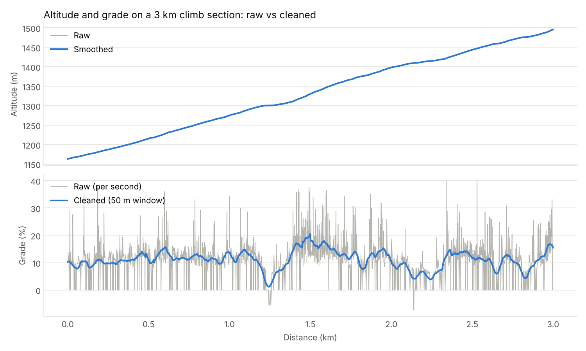
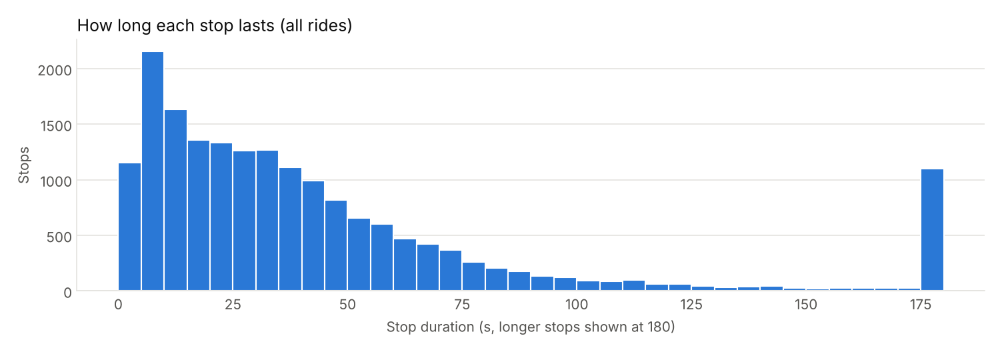

# Data cleaning

Generated by `scripts/report_cleaning.py`.

Every ride keeps one row per second; cleaning adds flags and smoothed columns.

| Problem | Method |
|---|---|
| GPS spikes | Drop points more than 50 m from the 7-second rolling-median track, or implying > 90 km/h; refill gaps up to 10 s by interpolation |
| Stops (incl. device auto-pause) | A second is a stop candidate if paused, slower than 1 m/s, or missing. A run of candidates is a **stop** if the position before and after differs by < 30 m, otherwise a **recording gap while moving**. Stops < 3 s apart are merged |
| Noisy altitude | 5 s rolling median (spikes) then 15 s rolling mean (jitter) |
| Noisy grade | Grade from smoothed altitude 25 m behind and 25 m ahead on the road, clipped to ±25% |

## Checks against Strava

- Moving time: median ratio ours / Strava = **0.989**
- Elevation gain: median ratio ours / Strava = **0.97** (rides with > 50 m gain)
- **18,322 stop events**, 92% of them last two minutes or less (traffic-light territory)

