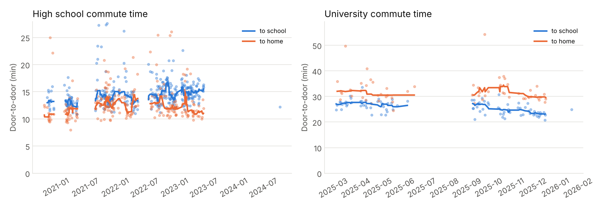

# Commutes

Generated by `scripts/commute_routes.py`. Times are door to door (from pressing start
to pressing stop), including traffic lights.

- **742 commutes**: 586 to/from high school
  (2020–2023, 4 km) and 156 to/from university
  (2025–2026, 8–9 km).

## Route variants

Rides are grouped into variants when at least 80% of each ride lies within ~80 m
(one grid cell) of the other. Variant A is the most ridden one; variants with fewer than 5 rides are hidden.

| Route | Variant | Rides | Distance (km) | Median time | Slowest 10% | Spread (std) | Lights (mean wait) | Moving speed |
|---|---|---|---|---|---|---|---|---|
| Home → university | A | 49 | 8.3 | 25:58 | 28:37 | 2:33 | 4:48 | 25.0 km/h |
| Home → university | B | 21 | 8.3 | 25:17 | 27:54 | 2:11 | 4:36 | 25.4 km/h |
| Home → university | C | 7 | 8.3 | 27:11 | 28:24 | 2:41 | 3:56 | 22.4 km/h |
| Home → university | D | 5 | 8.4 | 27:13 | 28:28 | 2:27 | 5:01 | 25.5 km/h |
| University → home | A | 28 | 9.0 | 30:44 | 35:19 | 3:05 | 5:02 | 22.0 km/h |
| University → home | B | 18 | 8.8 | 30:06 | 34:49 | 2:59 | 4:59 | 21.3 km/h |
| University → home | C | 5 | 8.5 | 29:54 | 33:03 | 2:30 | 4:04 | 20.9 km/h |
| Home → high school | A | 294 | 3.9 | 14:17 | 16:48 | 1:51 | 2:09 | 20.9 km/h |
| Home → high school | B | 14 | 3.9 | 13:07 | 15:54 | 2:08 | 1:10 | 21.4 km/h |
| Home → high school | C | 14 | 4.2 | 13:53 | 22:42 | 6:02 | 1:32 | 23.4 km/h |
| High school → home | A | 183 | 4.2 | 11:58 | 14:13 | 1:34 | 1:58 | 27.2 km/h |
| High school → home | B | 14 | 3.9 | 16:44 | 25:14 | 6:26 | 3:00 | 24.4 km/h |
| High school → home | C | 11 | 4.3 | 11:31 | 13:51 | 2:31 | 1:50 | 27.0 km/h |
| High school → home | D | 11 | 4.6 | 18:20 | 21:21 | 2:23 | 2:00 | 25.8 km/h |
| High school → home | E | 7 | 4.3 | 13:18 | 14:01 | 0:50 | 2:01 | 24.5 km/h |
| High school → home | F | 6 | 4.6 | 13:53 | 16:01 | 2:01 | 2:16 | 27.2 km/h |

- **Home → university:** variant B was 0:41 faster than the usual variant A (median), but ridden only 21 times.
- **University → home:** variant B was 0:38 faster than the usual variant A (median), but ridden only 18 times.
- **Home → high school:** variant B was 1:10 faster than the usual variant A (median), but ridden only 14 times.
- **High school → home:** variant C was 0:27 faster than the usual variant A (median), but ridden only 11 times.

## Leave-by calculator

When to leave home to reach campus by **09:00**, from the last 12 months of rides.
"95% sure" means that on 95% of past days you would have arrived in time.
Run `python scripts/leave_by.py --arrive 08:10` for any other time.

| Bike | Rides | 50% sure | 80% sure | 95% sure |
|---|---|---|---|---|
| Own bike | 68 | 08:35 | 08:32 | 08:31 |
| YouBike | 23 | 08:32 | 08:31 | 08:29 |

## Out vs back (own bikes)

| Route | Rides | Median time | Distance (km) | Moving speed | Climbing (m) | Avg heart rate | Waiting at lights |
|---|---|---|---|---|---|---|---|
| Home → high school | 338 | 14:16 | 4.0 | 21.0 km/h | 46 | 149 bpm | 2:03 |
| High school → home | 246 | 12:14 | 4.2 | 26.8 km/h | 15 | 136 bpm | 2:00 |
| Home → university | 68 | 24:58 | 8.4 | 25.6 km/h | 11 | 141 bpm | 4:35 |
| University → home | 51 | 30:55 | 8.9 | 21.7 km/h | 83 | 141 bpm | 4:38 |

## YouBike vs own bike (university commute)

| Bike | Rides | Median time | Moving speed | Waiting at lights |
|---|---|---|---|---|
| Own road bike | 119 | 27:27 | 24.0 km/h | 4:37 |
| YouBike | 37 | 28:20 | 21.8 km/h | 4:28 |
