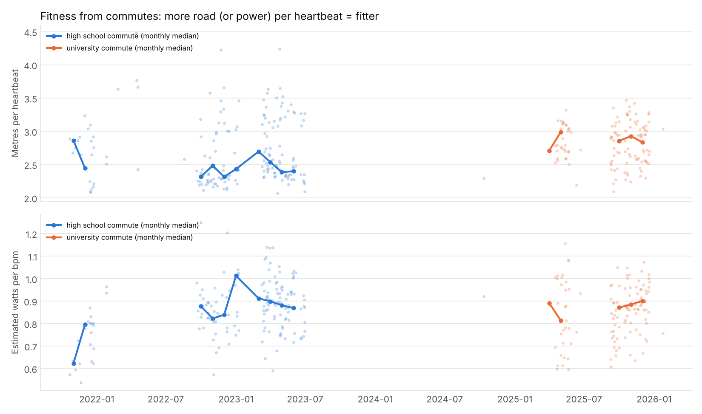
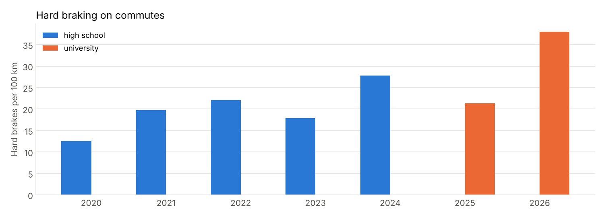

# Fitness and safety from commutes

Generated by `scripts/fitness_braking.py`.

## Fitness: the commute as a daily test

Riding the same route hundreds of times is a repeated, free fitness test. Two measures
over the moving seconds of each commute with heart rate:

- **Metres per heartbeat**: road covered per beat. Simple and works without altitude.
- **Watts per bpm** (efficiency factor): estimated power from the physics model divided
  by heart rate. Corrects for wind-free terrain differences, needs altitude.

Only own-bike commutes are used (a heavy upright YouBike is not comparable), and
values should be compared within one route (the routes differ in hills and traffic).

| Route | Year | Rides with HR | Moving speed | Avg HR | Metres / beat | Watts / bpm (est.) |
|---|---|---|---|---|---|---|
| high school | 2021 | 19 | 24.7 km/h | 153 | 2.75 | 0.72 |
| high school | 2022 | 67 | 21.8 km/h | 148 | 2.41 | 0.85 |
| high school | 2023 | 93 | 22.5 km/h | 141 | 2.52 | 0.89 |
| high school | 2024 | 1 | 21.1 km/h | 153 | 2.29 | 0.92 |
| university | 2025 | 117 | 23.9 km/h | 141 | 2.79 | 0.87 |
| university | 2026 | 1 | 26.7 km/h | 147 | 3.03 | 0.76 |

On the same high-school route, estimated watts per bpm went from **0.72 (2021) to 0.89 (2023)**, +24%: the same effort at a lower heart rate. (2021 has only 19 rides with heart rate, so treat it as indicative.)

## Hard braking

A hard brake is losing ≥ 4 m/s (14 km/h) within 2 s from above 15 km/h, about 0.2 g;
larger drops are GPS artefacts. Events within 10 s count once.

- **767 hard brakes** on 742 commutes (3,759 km):
  **20.4 per 100 km**.
- **53 hotspots** (≥ 4 hard brakes within 30 m);
  **16 of them are not at a traffic light** — places where something
  unexpected (cars turning or pulling out, pedestrians, scooters) makes you brake.

| Hotspot | Hard brakes | Rides through | Per 100 rides | At a traffic light |
|---|---|---|---|---|
| H0 | 38 | 231 | 16 | yes |
| H1 | 30 | 262 | 11 | yes |
| H2 | 21 | 387 | 5 | **no** |
| H3 | 19 | 421 | 5 | **no** |
| H4 | 18 | 307 | 6 | yes |
| H5 | 17 | 148 | 11 | yes |
| H6 | 17 | 332 | 5 | yes |
| H7 | 17 | 529 | 3 | yes |
| H8 | 17 | 204 | 8 | **no** |
| H9 | 16 | 544 | 3 | yes |

