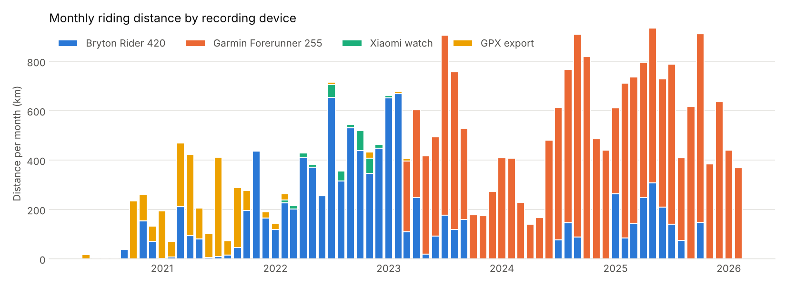
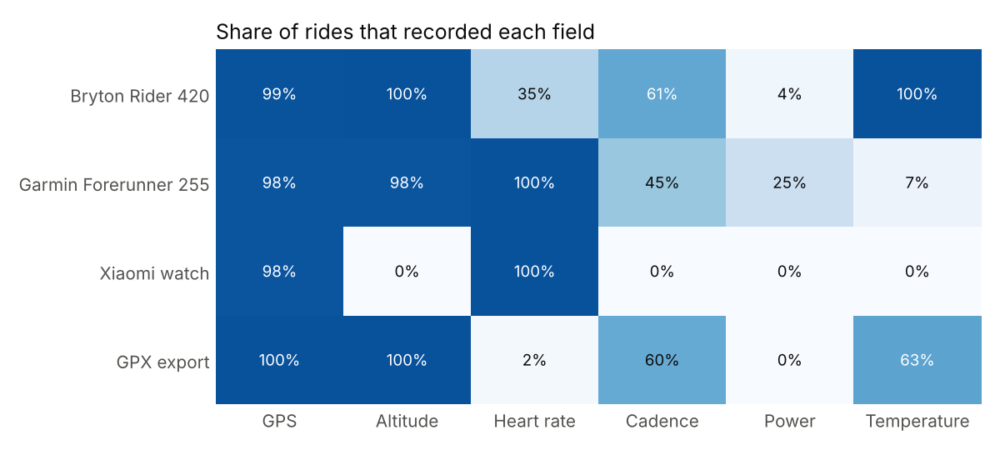

# Data inventory

Generated by `scripts/inventory.py` from the Strava bulk export. Only aggregates are shown; no GPS coordinates or ride names.

## Overview

| Item | Value |
|---|---|
| Rides (after removing duplicates) | 1,769 |
| Date range | 2020-05-24 – 2026-02-21 |
| Total distance | 29,595 km |
| Total moving time | 1,316 h |
| Rides with GPS | 1,750 |
| Rides without GPS (indoor / trainer) | 19 |
| Rides outside Taiwan | 19 |
| Same ride recorded on two devices (one copy kept) | 16 |
| Rides with a power meter | 237 |

## Rides per year

A ride *has* a field when more than half of its recorded seconds contain it.

| Year | Rides | Distance (km) | Moving time (h) | With heart rate | With cadence | With power meter |
|---|---|---|---|---|---|---|
| 2020 | 64 | 684 | 31 | 0 | 42 | 0 |
| 2021 | 342 | 3149 | 142 | 37 | 268 | 0 |
| 2022 | 408 | 4730 | 217 | 206 | 196 | 0 |
| 2023 | 345 | 6079 | 263 | 295 | 32 | 0 |
| 2024 | 216 | 5873 | 254 | 216 | 58 | 51 |
| 2025 | 371 | 8270 | 372 | 370 | 292 | 169 |
| 2026 | 23 | 810 | 36 | 23 | 17 | 17 |

## Recording devices

Share of rides that recorded each field:

| Device | Rides | Period | GPS | Altitude | Heart rate | Cadence | Power | Temperature | Auto-pause events |
|---|---|---|---|---|---|---|---|---|---|
| Bryton Rider 420 | 747 | 2020-09 – 2025-10 | 99% | 100% | 35% | 61% | 4% | 100% | 97% |
| Garmin Forerunner 255 | 820 | 2023-03 – 2026-02 | 98% | 98% | 100% | 45% | 25% | 7% | 94% |
| Xiaomi watch | 63 | 2022-02 – 2023-01 | 98% | 0% | 100% | 0% | 0% | 0% | 0% |
| GPX export | 139 | 2020-05 – 2023-03 | 100% | 100% | 2% | 60% | 0% | 63% | 0% |

## Bikes

| Bike (Strava gear) | Rides | Distance (km) | With power meter |
|---|---|---|---|
| TCR BLACK | 740 | 20635 | 229 |
| Reacto 400 | 737 | 7112 | 7 |
| Ubike | 142 | 844 | 1 |
| MATTS 6.40 | 118 | 457 | 0 |
| (none) | 19 | 272 | 0 |
| XTC | 10 | 213 | 0 |
| Helloride | 2 | 54 | 0 |
| Ubike E | 1 | 8 | 0 |

## Power meter rides

- **237 rides** with real power data, 2024-10-12 – 2026-02-21.
- By bike: TCR BLACK 229, Reacto 400 7, Ubike 1.
- Strava fills *Average Watts* with its own estimate for rides without a power meter, so the data files (not the CSV) decide which rides have power. Strava's weighted-power column agrees with the files for 100% of rides.

## Data quirks handled during parsing

- **Malformed FIT files (Xiaomi watch, 2022–2023):** multi-byte fields stored as big-endian byte arrays; decoded manually.
- **Placeholder values:** sensors that are absent but written as constants (distance 0, altitude −500 m, heart rate 0) are treated as missing.
- **Split recordings:** one file split into several Strava activities is cropped to each activity's time window.
- **Auto-pause:** FIT timer stop/start events become the `is_paused` flag, which is how stops at traffic lights will be measured.
