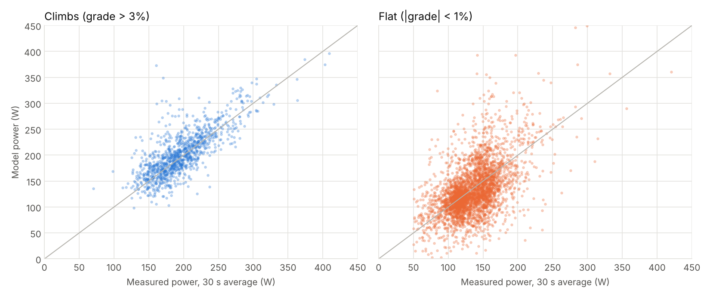
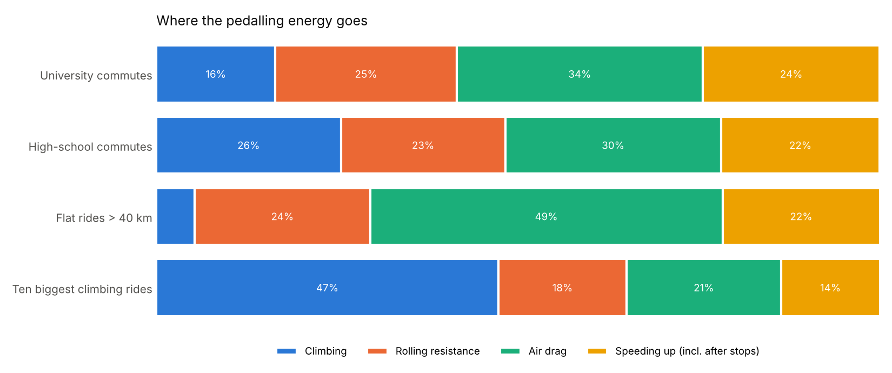
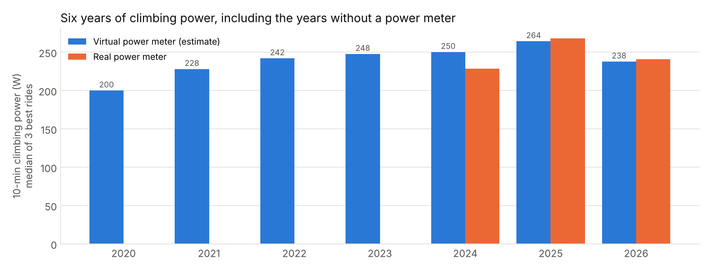

# Physics model and virtual power meter

Generated by `scripts/physics_report.py`.

## Model

Power at the pedals is the sum of four terms divided by drivetrain efficiency (η = 0.977):

| Term | Formula | Meaning |
|---|---|---|
| Gravity | m·g·v·sin θ | climbing (negative downhill) |
| Rolling | Crr·m·g·v·cos θ | tyre and road losses |
| Air drag | ½·ρ·CdA·v³ | ρ from altitude and temperature |
| Acceleration | m·v·dv/dt | speeding up, e.g. after a red light |

Mass m = rider 69 kg + kit 1.5 kg + TCR 8 kg = **78.5 kg**.

## Calibration

Rearranged, the model is a linear regression with two unknowns and no intercept:
**η·P − P_gravity − P_accel = CdA · (½ρv³) + Crr · (m g v cos θ)**.
It is fitted with robust least squares (soft-L1 loss, so windows hit by gusts count
less) on **30-second windows of steady riding** (moving, > 3 m/s, > 50 W, |accel| < 0.3 m/s²)
from **228 TCR rides with a power meter**. 20% of rides are held out for testing —
whole rides, because neighbouring seconds of one ride are near copies.

| | CdA (m²) | Crr |
|---|---|---|
| Fit on training rides | **0.255** | **0.0084** |
| 5-fold CV by ride (mean ± std) | 0.257 ± 0.003 | 0.0084 ± 0.0001 |

CdA and Crr are partly interchangeable (both grow with speed), so the pair is less
certain than either total. The fitted Crr is higher than a racing tyre on smooth
tarmac (~0.004–0.006). Plausible reasons: city roads, and a real mass above the
assumed 78.5 kg (backpack). Fixing Crr at 0.005 and fitting only CdA gave
CdA ≈ 0.30 but a *larger* held-out error on the flat, so the joint fit is kept.

## Accuracy on held-out rides

| Terrain | Windows | MAE | RMSE | Bias | Relative error |
|---|---|---|---|---|---|
| All | 7441 | 35 W | 56 W | -6 W | 28% |
| Climbs (> 3%) | 1074 | 21 W | 30 W | +6 W | 12% |
| Flat (< 1%) | 3519 | 31 W | 42 W | -3 W | 23% |
| Rolling (1–3%) | 2604 | 36 W | 49 W | -3 W | 28% |

- **Whole-ride average power** (45 held-out rides): MAE **12 W**
  (10%), bias +7 W.
- **Best 10-minute climbing power** (25 held-out rides with such a climb):
  MAE **10 W** (5%).

As expected, **climbs are accurate** (gravity dominates and is known exactly) while
**the flat is harder** (air drag dominates, and without wind data a 10 km/h headwind
looks like a weaker rider).

## Where the energy goes

## Virtual power meter

The calibrated model estimates power for every ride with speed and altitude, including
the four years before the power meter. Reacto rides reuse the TCR CdA/Crr with its own
mass; MTB and YouBike use assumed values (MATTS 6.40: CdA 0.45, Crr 0.01, Ubike: CdA 0.55, Crr 0.01).

Each bar is the median of the three best rides of the year (one ride with a tailwind or
drafting cannot dominate). In 2025–2026 estimate and measurement agree within a few
watts; in 2024 the power meter only arrived in October, so the estimate also covers
earlier, stronger rides. The trend: **~200 W in 2020 → ~250–265 W from 2023 on**.

## The energy cost of red lights

Getting back to cruising speed after a stop costs the kinetic energy ½·m·v² / η.

- One stop on the university commute (cruising 23 km/h): **1.7 kJ**
  at the pedals ≈ **1.7 kcal** of food (24% muscle efficiency).
- Per university commute: **15 kcal** just for restarting after lights.
- All commutes since 2020: **5,913 kcal** ≈ 12 cups of bubble tea (≈ 500 kcal each).
