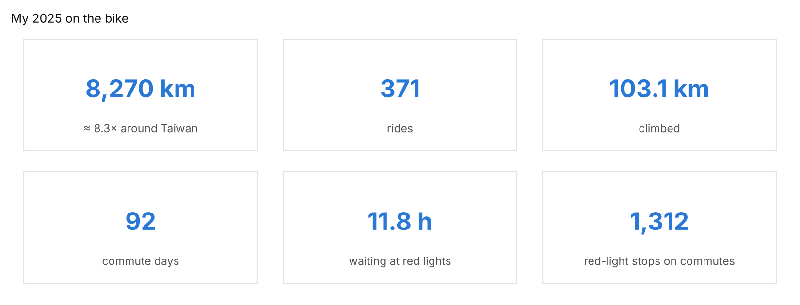
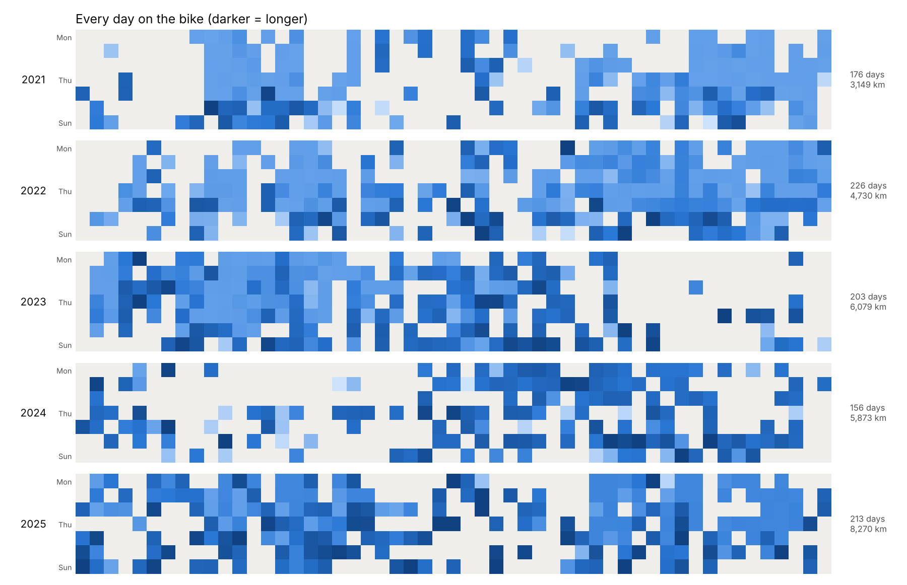

# Recap

Generated by `scripts/recap.py`.

**1,769 rides and 29,595 km since May 2020** — about
30 times around Taiwan. Of that, 3,759 km were
commutes to high school and university.

## Year by year

| Year | Rides | Distance | ≈ Round-Taiwan trips | Climbing | Riding days | Commute days | Waiting at lights | Earliest departure | Fuel saved vs scooter |
|---|---|---|---|---|---|---|---|---|---|
| 2020 | 64 | 684 km | 0.7 | 8,499 m | 37 | 16 | 0.6 h | 06:38 | NT$90 / 7 kg CO₂ |
| 2021 | 342 | 3,149 km | 3.1 | 34,996 m | 176 | 104 | 6.5 h | 06:44 | NT$608 / 47 kg CO₂ |
| 2022 | 408 | 4,730 km | 4.7 | 56,471 m | 226 | 138 | 8.0 h | 06:48 | NT$690 / 53 kg CO₂ |
| 2023 | 345 | 6,079 km | 6.1 | 73,217 m | 205 | 87 | 4.8 h | 07:17 | NT$423 / 32 kg CO₂ |
| 2024 | 216 | 5,873 km | 5.9 | 59,520 m | 160 | 1 | 0.0 h | 14:02 | NT$3 / 0 kg CO₂ |
| 2025 | 371 | 8,270 km | 8.3 | 103,098 m | 222 | 92 | 11.8 h | 08:23 | NT$1,000 / 77 kg CO₂ |
| 2026 | 23 | 810 km | 0.8 | 9,452 m | 18 | 1 | 0.1 h | 13:45 | NT$6 / 0 kg CO₂ |

Fuel and CO₂ compare commute kilometres with a typical 125 cc scooter
(2.5 L/100 km, NT$30/L, 2.3 kg CO₂/L). 2020 and 2026 are partial years.
