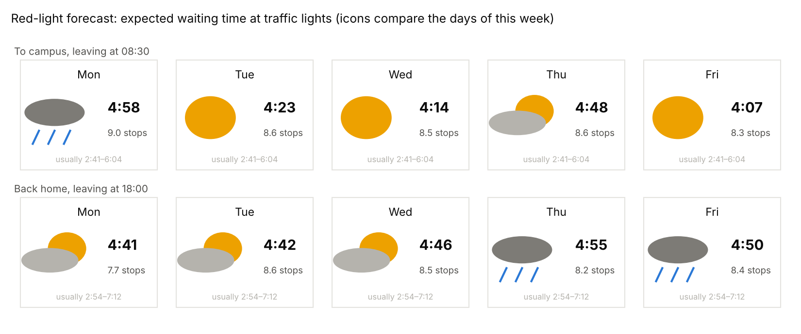
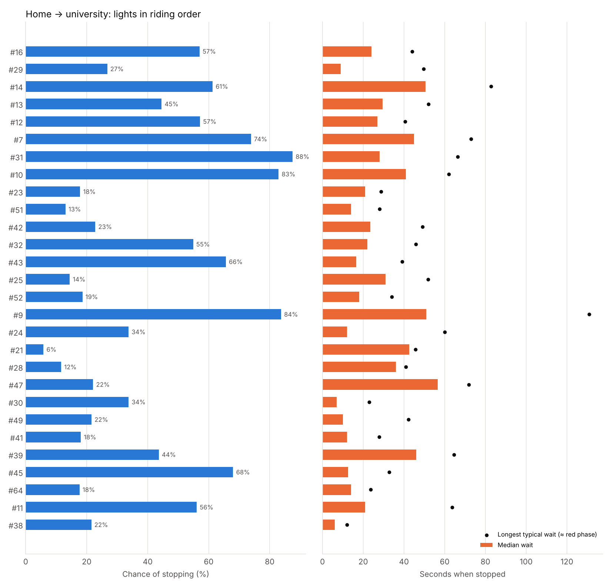
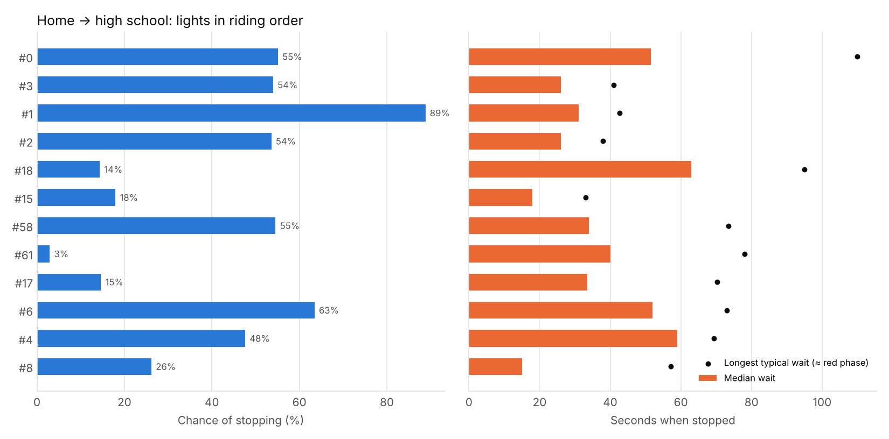
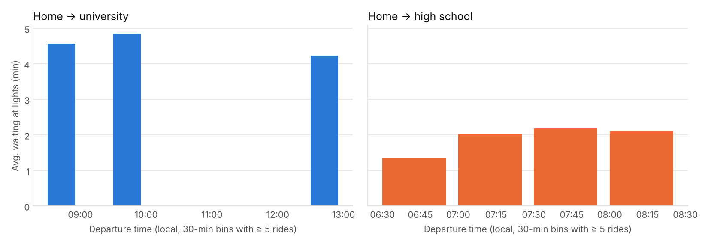

# Traffic lights

Generated by `scripts/traffic_lights.py`.

**How it works.** Stops on commutes (excluding 200 m around home/school and stops
over 3 minutes) are clustered within 30 m; every cluster with ≥ 8 stops is treated as a
traffic light. For each commute we then check which lights it passed (track within
35 m) and whether it stopped there. Stop chance uses add-one smoothing, and the
95th-percentile wait estimates the red phase (arriving just as it turns red).
Lights are shown by ID only; their locations stay private.

- **65 traffic lights** found from **3,738 stops** on **742 commutes**.
- Lifetime ledger: **31.7 h** waiting at commute lights, and
  **170 h** in all short stops (≤ 3 min) across every ride since 2020.

## Per route

| Route | Commutes | Lights passed (median) | Stops (mean) | Waiting (mean) | Share of ride time | Forecast error (MAE) | Naive error |
|---|---|---|---|---|---|---|---|
| Home → university | 91 | 22 | 8.6 | 4:36 | 18% | 0:53 | 0:49 |
| University → home | 65 | 27 | 8.2 | 4:33 | 14% | 1:20 | 0:56 |
| Home → high school | 339 | 9 | 3.5 | 2:02 | 14% | 0:41 | 0:41 |
| High school → home | 247 | 6 | 2.5 | 2:00 | 15% | 0:57 | 0:57 |

*Forecast error*: forecast the last 20% of commutes (chronologically) from the earlier
ones, using same-weekday rides within ±1 h of the departure time, shrunk toward all
rides in that time window. *Naive*: always predict the overall average.

## Red-light forecast

**Honest finding:** the forecast is barely better (sometimes worse) than always
guessing the average. Which lights turn red for you is close to random; weekday and
departure time explain little of the day-to-day spread. What *is* predictable is the
typical cost of a route and its range ("usually 2:41–6:04"), which is what the card
shows. Where departure time does matter, see *Best time to leave* below.

## The worst lights

| Light | Route | Passes | Chance of red | Median wait | ≈ Red phase | Expected cost per pass |
|---|---|---|---|---|---|---|
| #9 | Home → university | 84 | 84% | 0:51 | 2:11 | 0:44 |
| #19 | University → home | 57 | 75% | 1:05 | 1:29 | 0:40 |
| #7 | University → home | 59 | 85% | 0:31 | 1:30 | 0:35 |
| #10 | Home → university | 80 | 83% | 0:41 | 1:02 | 0:33 |
| #0 | High school → home | 223 | 62% | 0:56 | 1:20 | 0:32 |
| #0 | Home → high school | 312 | 55% | 0:52 | 1:50 | 0:32 |
| #7 | Home → university | 86 | 74% | 0:45 | 1:13 | 0:32 |
| #14 | Home → university | 91 | 61% | 0:50 | 1:23 | 0:30 |

## Best time to leave

## Green waves: are neighbouring lights linked?

If light B is coordinated with light A, catching green at A should make green at B
more likely. The table lists the pairs where the outcome at A changes the chance of
red at B the most; the travel-time columns show whether riding faster between them
helps.

| Pair | Route | Rides | Red at next if green here | Red at next if red here | Travel time if next is green | … if next is red |
|---|---|---|---|---|---|---|
| #25 → #52 | Home → university | 84 | 8% | 90% | 8 s | 17 s |
| #26 → #22 | University → home | 54 | 39% | 87% | 58 s | 78 s |
| #17 → #6 | Home → high school | 165 | 63% | 100% | 13 s | 18 s |
| #48 → #40 | University → home | 58 | 32% | 59% | 56 s | 56 s |
| #7 → #12 | University → home | 59 | 0% | 24% | 100 s | – |
| #37 → #25 | University → home | 56 | 32% | 50% | 70 s | 92 s |

Pairs only a few seconds apart with "red here → red next" close to 100% are most
likely a **two-stage left turn** (wait for one light, roll to the waiting box, wait
for the crossing light, whose phase is opposite). Pairs where the travel time when
the next light is green is clearly shorter than when it is red suggest that
**riding a little faster between them catches the green**.
