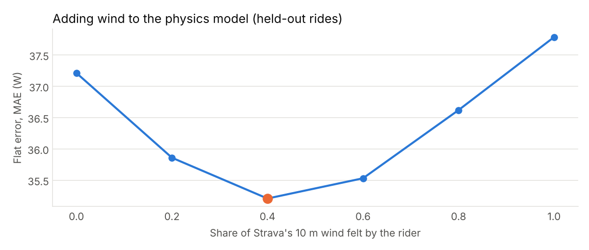
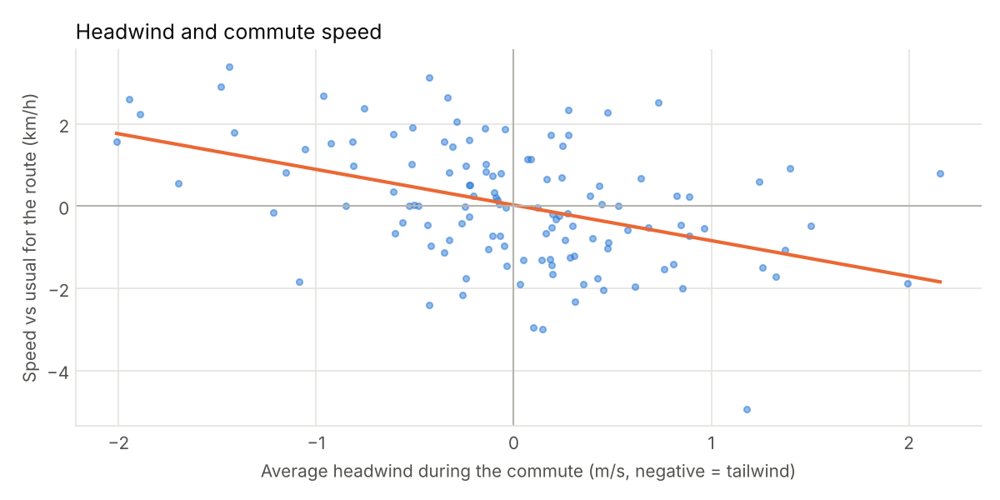
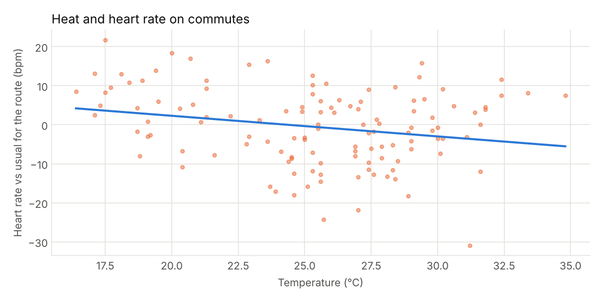

# Weather

Generated by `scripts/weather_effects.py`. Strava attached weather (temperature, wind
speed and direction, rain) to **439 activities** (May 2023 – Feb 2026).
Wind is measured at 10 m height, so only part of it reaches a rider between buildings.

## Wind makes the physics model better on the flat

The air speed in the drag term becomes *ground speed + factor × headwind component*, where
the headwind component is computed every second from the rider's heading. CdA/Crr are
refitted for each factor on the training rides; the error is measured on the same
held-out rides as in the physics report (123 power rides with weather,
27 held out).

| Wind factor | CdA | Crr | Flat MAE | All terrain MAE |
|---|---|---|---|---|
| 0.0 | 0.261 | 0.0086 | 37.2 W | 39.6 W |
| 0.2 | 0.265 | 0.0084 | 35.9 W | 39.0 W |
| 0.4 | 0.259 | 0.0089 | 35.2 W | 39.4 W |
| 0.6 | 0.242 | 0.0098 | 35.5 W | 40.9 W |
| 0.8 | 0.221 | 0.0111 | 36.6 W | 43.1 W |
| 1.0 | 0.196 | 0.0124 | 37.8 W | 45.4 W |

Best factor **0.4**: flat error 37.2 W → **35.2 W**
(-5%).

## Headwind on the commute

124 own-bike commutes with weather. Speed is compared with the usual speed of the
same route and direction.

- Each **1 m/s of headwind** (felt, factor 0.4) changes moving speed by
  **-0.87 km/h** (90% bootstrap interval -1.17 to
  -0.59; R² = 0.19).
- On the 8.5 km university commute that is about **+48 s per m/s of headwind**.

## Heat

Average heart rate vs temperature, controlling for speed (linear regression on
123 commutes): **+0.6 bpm per +10 °C** at the same speed — no clear
heat effect. Commutes only span 16–35 °C and are short, so
heat has little time to build up; a long summer climb would be the better test.

## Rain

| Conditions | Commutes | Speed vs usual |
|---|---|---|
| Dry | 120 | +0.0 km/h |
| Rain (≥ 0.5 mm/h) | 4 | +0.6 km/h |

Only 4 commutes had rain at the start, too few to conclude anything.
Rainy days
probably show up mostly as *missing* commutes (another way to school).
